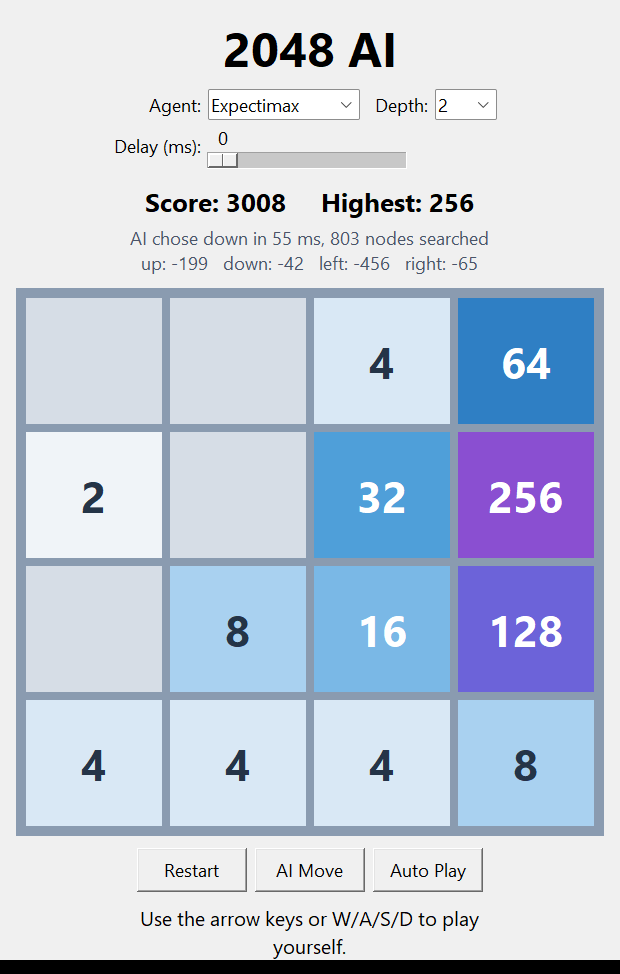

# 2048 AI with Expectimax Search

Artificial Intelligence Lab project (AL-2002), FAST NUCES Karachi.

An AI that plays the 2048 puzzle. Its core is **Expectimax search**: MAX nodes
for our moves, CHANCE nodes for the random 2/4 tile, and a heuristic that scores
boards at the depth limit. It is compared with a **Random** and a **Greedy**
agent on the same 50 seeded games.



## How to run

Python 3.9+. Everything except the charts uses only the standard library.

```bash
python main.py                      # open the game: play with arrow keys/WASD or let an AI play
python -m unittest tests -v         # run all tests
python experiments.py --quick       # 1-minute check that experiments work
python experiments.py               # full comparison on seeds 1-50 (about 1.5 hours on 8 cores)
python experiments.py --tune        # grid search for heuristic weights (seeds 51-70)
pip install -r requirements.txt     # matplotlib, needed only for charts
python charts.py                    # draw charts from results/final/per_game.csv
```

## Architecture

Five program files in layers; each file only uses the files below it.

```text
   main.py           experiments.py          charts.py
   (window)          (play many games,       (CSV -> pictures)
      |               write CSV)                  ^
      +--------+-----------+                      |
               v                       results/final/per_game.csv
          agents.py      which move is best?    Random, Greedy, Expectimax + heuristic
               |
               v
           game.py       what happens if I move?    all the rules of 2048
```

| File | Job | Main pieces |
|---|---|---|
| `game.py` | The rules of 2048 | `slide_board` (move without spawning), `possible_moves`, `can_move`, `GameState` (`play`, `spawn`, `legal_moves`, `is_terminal`) |
| `agents.py` | Choosing moves | `evaluate_board` (heuristic), `RandomAgent`, `GreedyAgent`, `ExpectimaxAgent` (`_max_value`, `_chance_value`, transposition table) |
| `main.py` | Tkinter window | Board, score, agent/depth/speed choice, AI Move, Auto Play, Restart. The AI runs in a background thread so the window never freezes. |
| `experiments.py` | Measuring | `--tune` grid search; the 50-seed comparison and ablation → `per_game.csv`, `summary.csv` |
| `charts.py` | Pictures | Six PNG charts in `results/charts/`, computed only from the CSV |
| `tests.py` | Checking | 22 tests: rules, agents, Expectimax maths, experiments, window |

**How one AI move flows:** `main.py` gives the current board to the chosen agent →
the agent explores future boards with `game.py`'s `slide_board` (no randomness,
no copying of the real game) and Expectimax averages over every possible new
tile → it returns the best direction → `main.py` calls `state.play(direction)`,
which moves and spawns a real random tile → the board is redrawn.

**Key design decisions**

* `move()` changes the board without spawning; `play()` = move + spawn. The AI
  can explore "what if" boards with no randomness, and Expectimax models the
  random tile explicitly at chance nodes.
* The AI searches with immutable board tuples, so nothing is copied and boards
  can be cache keys. Depth 2 went from 385 ms to about 17 ms per move.
* A board with no legal move scores −100000, so the agent avoids even a small
  chance of losing.
* Weights (empty 100, monotonicity 20, smoothness 11, corner 0) were tuned on
  seeds 51–70; the evaluation uses seeds 1–50.

**[VIVA_GUIDE.md](VIVA_GUIDE.md)** explains every part step by step, with a dry
run of Expectimax beating Greedy and answers to likely viva questions.

## Results

*Filled in from `results/final/summary.csv` after the full experiment.*
